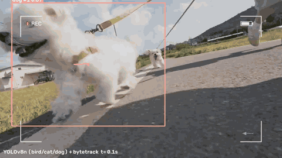
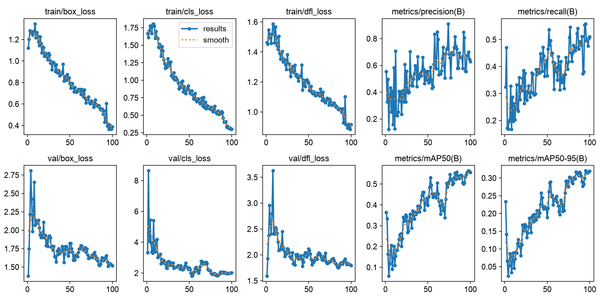

# YOLOv8 객체 감지·추적 과제 (dog / cat / bird)

YOLOv8n을 3개 부류(bird, cat, dog)로 전이학습하고, 학습한 모델로 동영상에서 객체를 감지·추적(ByteTrack)하고, 이동 궤적(trajectory) 저장과 객체 카운팅까지 한 과제입니다.

## 바로 보기

| 결과물 | 파일 |
|---|---|
| **학습된 모델** | [`01_trained_model/best.pt`](01_trained_model/best.pt) (YOLOv8n, 6.5MB) |
| **10초 추적 영상** | [`02_result_videos/1_tracking_10s.mp4`](02_result_videos/1_tracking_10s.mp4) |
| **10초 카운팅 영상** | [`02_result_videos/2_counting_10s.mp4`](02_result_videos/2_counting_10s.mp4) |
| **우리 집 강아지 꼬맹이 · 주남이 추적 영상 (14초)** | [`02_result_videos/3_kkomaeng_junam_tracking_14s.mp4`](02_result_videos/3_kkomaeng_junam_tracking_14s.mp4) |
| 5초 추적 영상 (과제 요구 분량, 3.5~8.5초 구간) | [`02_result_videos/etc/tracking_5s_3.5-8.5s.mp4`](02_result_videos/etc/tracking_5s_3.5-8.5s.mp4) |



> 원본 영상: "역대급 산책에 신난 강아지들", 재롱잔치 — https://www.youtube.com/watch?v=Qw8P4S_XXoQ
> (YouTube 크리에이티브 커먼즈 저작자 표시 라이선스, 재사용 허용). 처음 10초를 잘라 추적 결과를 덧입혔습니다.

## 폴더 구성

```
01_trained_model/      학습된 모델 best.pt
02_result_videos/      추적·카운팅 결과 영상
data/selection.csv     데이터셋 이미지 목록 (부류별 100장)
docs/images/           Roboflow 작업 화면, README 미리보기
input_videos/          추적에 사용한 입력 영상 (YouTube 10초, 꼬맹이 · 주남이 14초)
scripts/               데이터 수집 · 학습 · 추적 · 카운팅 코드
training_results/      학습 곡선, 혼동 행렬, PR 곡선, valid/test 예측 결과
trajectories/          객체별 이동 궤적 (CSV, 그림) · 카운팅 결과 (JSON)
```

## 1. 데이터셋

| 항목 | 내용 |
|---|---|
| 이미지 출처 | COCO 2017 train (객체 감지 공개 데이터셋) |
| 부류 / 이미지 수 | bird 100 · cat 100 · dog 100 → **총 300장** |
| 박스 수 | 421개 (bird 145 · cat 138 · dog 138) |
| 라벨링 도구 | **Roboflow** (YOLO 포맷 라벨과 함께 업로드 → 검수 → 분할 → 버전 생성 → YOLOv8 포맷 내보내기) |
| 분할 | **Train 70% (210) / Valid 20% (60) / Test 10% (30)** |
| 전처리 · 증강 (Roboflow) | 없음 (YOLOv8 학습 시 기본 증강 사용) |
| 공개 데이터셋 | https://universe.roboflow.com/s-workspace-5ejf0/pets-dog-cat-bird/dataset/1 |

이미지 선택 기준: 해당 동물이 이미지 면적의 2% 이상, crowd(군집) 라벨이 있는 이미지 제외, 시드 고정 무작위 추출
([`scripts/prepare_roboflow_upload.py`](scripts/prepare_roboflow_upload.py)).

## 2. 학습

| 항목 | 값 |
|---|---|
| 모델 | YOLOv8n (COCO 사전학습 `yolov8n.pt`에서 전이학습) |
| 라이브러리 | Ultralytics 8.4.218, PyTorch 2.15 |
| 장치 | Apple M1 Max GPU (MPS) |
| Epochs / imgsz / batch | 100 / 640 / 16 (optimizer auto → AdamW) |
| 학습 시간 | 약 13분 |

```bash
python scripts/train.py --epochs 100
```

### 성능

| 세트 | 클래스 | Precision | Recall | mAP50 | mAP50-95 |
|---|---|---|---|---|---|
| Valid (60장) | **all** | 0.554 | 0.558 | **0.544** | 0.320 |
| | bird | 0.533 | 0.524 | 0.528 | 0.316 |
| | cat | 0.642 | 0.568 | 0.559 | 0.303 |
| | dog | 0.486 | 0.583 | 0.545 | 0.341 |
| Test (30장) | **all** | 0.539 | 0.435 | **0.413** | 0.245 |
| | bird | 0.632 | 0.562 | 0.496 | 0.319 |
| | cat | 0.659 | 0.529 | 0.563 | 0.284 |
| | dog | 0.326 | 0.214 | 0.181 | 0.132 |



첫 시도는 `patience=20`(조기 종료)으로 21 에폭에서 멈춰 valid mAP50 0.364에 그쳤고,
조기 종료를 끄고 100 에폭 학습해 valid mAP50 0.544로 올렸습니다 ([`training_results/train_try1_e21`](training_results/train_try1_e21)).

## 3. 객체 추적 · 궤적 저장

```bash
python scripts/track.py --source input_videos/input_dogs_walk_10s.mp4 --duration 10 --conf 0.1 --tracker bytetrack.yaml
```

- `model.track(..., persist=True, tracker="bytetrack.yaml")`로 프레임마다 ID를 유지
- Ultralytics object_tracking 예제처럼 박스 중심점을 이어 궤적을 그리고, **궤적을 따로 저장**하도록 코드를 수정
  - [`trajectories.csv`](trajectories/tracking_10s/trajectories.csv): `frame, time_sec, track_id, class, conf, cx, cy, x1, y1, x2, y2`
  - [`trajectories.png`](trajectories/tracking_10s/trajectories.png): ID별 전체 이동 경로

| 영상 | 강아지 감지 프레임 | 생성된 ID | 가장 오래 유지된 ID |
|---|---|---|---|
| 10초 (600 프레임) | 366 (61%) | 12 | dog #19 — 202 프레임 (3.4초) |
| 5초 (300 프레임, 3.5~8.5초) | 244 (81%) | 8 | dog #5 — 202 프레임 (3.4초) |

## 4. 객체 카운팅

```bash
python scripts/count.py --source input_videos/input_dogs_walk_10s.mp4 --line-y 0.48
```

Ultralytics `solutions.ObjectCounter`에 학습한 모델을 넣고, 화면 높이 48% 위치에 가로 선을 그어 선을 지나간 객체를 셌습니다.
결과: **dog IN 2 · OUT 1**, bird IN 1 (강아지를 bird로 잘못 분류한 오탐).

## 5. 추가 실험 — 우리 집 강아지 꼬맹이 · 주남이

직접 휴대폰으로 촬영한 14초 영상(1080×1920, 30fps, 장면 전환 없음)에 같은 모델로 추적을 적용했습니다.

```bash
python scripts/track.py --source input_videos/input_kkomaeng_junam_14s.mp4 --duration 15 --conf 0.1 --tracker bytetrack.yaml
```

| 항목 | 결과 |
|---|---|
| 객체가 감지된 프레임 | 368 / 422 (87%) |
| dog로 감지된 프레임 | 255 / 422 (60%) |
| 가장 오래 유지된 ID | #70 갈색 강아지 172 프레임 (5.7초) |
| 흰 강아지 | 후반부 #89로 60 프레임 추적, 전반부는 대부분 놓침 |

- 장면 전환이 없어 YouTube 영상보다 ID가 오래 유지됨
- 털을 짧게 깎은 모습·위에서 내려다본 각도가 COCO 사진과 달라 cat/bird로 잘못 분류되거나 흰 강아지를 놓침, 노란 장난감 오탐도 발생
- 궤적: [`trajectories/kkomaeng_junam_14s/`](trajectories/kkomaeng_junam_14s/)

## 한계

- 데이터 300장, nano 모델이라 test mAP50 0.41, 특히 dog test 성능(0.18)이 낮음
- 입력 영상에 장면 전환(4.05초, 7.9초)이 있어 장면이 바뀔 때마다 새 ID가 생기고, 카운팅이 중복될 수 있음

## 참고

- Ultralytics YOLOv8 — https://github.com/ultralytics/ultralytics (AGPL-3.0)
- Train / Track 문서 — https://docs.ultralytics.com/modes/train/ · https://docs.ultralytics.com/modes/track/
- COCO 2017 — https://cocodataset.org (어노테이션 CC BY 4.0)
- Roboflow — https://roboflow.com
