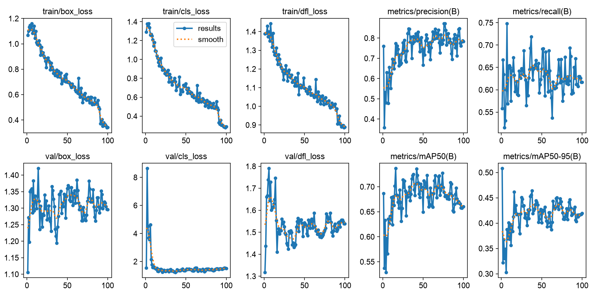
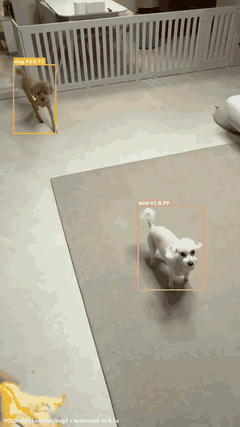

# YOLOv8 객체 감지·추적 과제 (dog / cat / bird)

YOLOv8n을 3개 부류(bird, cat, dog)로 전이학습하고, 학습한 모델로 동영상에서 객체를 감지·추적(ByteTrack)하고, 이동 궤적(trajectory) 저장과 객체 카운팅까지 한 과제입니다.

## 바로 보기

| 결과물 | 파일 |
|---|---|
| **학습된 모델** | [`01_trained_model/best.pt`](01_trained_model/best.pt) (YOLOv8n, 6.5MB) |
| **10초 추적 영상** | [`02_result_videos/1_tracking_10s.mp4`](02_result_videos/1_tracking_10s.mp4) |
| **10초 카운팅 영상** | [`02_result_videos/2_counting_10s.mp4`](02_result_videos/2_counting_10s.mp4) |
| **우리 집 강아지 꼬맹이 · 주남이 추적 영상 (14초)** | [`02_result_videos/3_kkomaeng_junam_tracking_14s.mp4`](02_result_videos/3_kkomaeng_junam_tracking_14s.mp4) |
| 5초 추적 영상 (과제 요구 분량, 3.5~8.5초 구간) | [`02_result_videos/etc/tracking_5s_3.5-8.5s.mp4`](02_result_videos/etc/tracking_5s_3.5-8.5s.mp4) |


> 원본 영상: "역대급 산책에 신난 강아지들", 재롱잔치 — https://www.youtube.com/watch?v=Qw8P4S_XXoQ
> (YouTube 크리에이티브 커먼즈 저작자 표시 라이선스, 재사용 허용). 처음 10초를 잘라 추적 결과를 덧입혔습니다.

## 폴더 구성

```
01_trained_model/      학습된 모델 best.pt
02_result_videos/      추적·카운팅 결과 영상
data/selection.csv     데이터셋 이미지 목록 (부류별 100장)
docs/images/           Roboflow 작업 화면, README 미리보기
input_videos/          추적에 사용한 입력 영상 (YouTube 10초, 꼬맹이 · 주남이 14초)
scripts/               데이터 수집 · 학습 · 추적 · 카운팅 코드
training_results/      학습 곡선, 혼동 행렬, PR 곡선, valid/test 예측 결과
trajectories/          객체별 이동 궤적 (CSV, 그림) · 카운팅 결과 (JSON)
```

## 1. 데이터셋

| 항목 | 내용 |
|---|---|
| 이미지 출처 | COCO 2017 train (객체 감지 공개 데이터셋) |
| 부류 / 이미지 수 | bird 100 · cat 100 · dog 100 → **총 300장** |
| 박스 수 | 421개 (bird 145 · cat 138 · dog 138) |
| 라벨링 도구 | **Roboflow** (YOLO 포맷 라벨과 함께 업로드 → 검수 → 분할 → 버전 생성 → YOLOv8 포맷 내보내기) |
| 분할 | **Train 70% (210) / Valid 20% (60) / Test 10% (30)** |
| 전처리 · 증강 (Roboflow) | 없음 (YOLOv8 학습 시 기본 증강 사용) |
| 공개 데이터셋 | https://universe.roboflow.com/s-workspace-5ejf0/pets-dog-cat-bird/dataset/1 |

이미지 선택 기준: 해당 동물이 이미지 면적의 2% 이상, crowd(군집) 라벨이 있는 이미지 제외, 시드 고정 무작위 추출
([`scripts/prepare_roboflow_upload.py`](scripts/prepare_roboflow_upload.py)).

## 2. 학습

| 항목 | 값 |
|---|---|
| 모델 | YOLOv8n (COCO 사전학습 `yolov8n.pt`에서 전이학습) |
| **최종 설정** | **백본 고정 (`freeze=10`)** — 특징 추출부(0~9층)는 COCO 가중치 그대로 두고 검출 헤드만 학습 |
| 라이브러리 | Ultralytics 8.4.218, PyTorch 2.15 |
| 장치 | Apple M1 Max GPU (MPS) |
| Epochs / imgsz / batch | 100 / 640 / 16 (optimizer auto → AdamW) |
| 학습 시간 | 약 10분 |

```bash
python scripts/train.py --epochs 100 --freeze 10
```

### 1차 → 2차 → 3차 학습 비교

| | 1차: 조기 종료 | 2차: 100 에폭 | **3차: 백본 고정 (최종)** |
|---|---|---|---|
| 설정 | `patience=20` → 21 에폭에서 멈춤 | `patience=100`, 전체 층 학습 | `freeze=10`, 헤드만 학습 |
| Valid mAP50 | 0.364 | 0.544 | **0.686** |
| Test mAP50 | 0.493 | 0.413 | **0.673** |
| Test mAP50 (dog) | 0.233 | 0.181 | **0.387** |
| Test mAP50-95 | 0.323 | 0.245 | **0.479** |

300장으로 전체 층을 다시 학습하면 COCO 12만 장으로 배운 특징을 잃어버려(catastrophic forgetting) 성능이 오히려 떨어졌습니다.
백본을 고정해 사전학습 특징을 유지하자 valid·test 모두 크게 올랐습니다.

### 최종 모델 성능 (3차)

| 세트 | 클래스 | Precision | Recall | mAP50 | mAP50-95 |
|---|---|---|---|---|---|
| Valid (60장) | **all** | 0.760 | 0.558 | **0.686** | 0.508 |
| | bird | 0.937 | 0.619 | 0.738 | 0.512 |
| | cat | 0.665 | 0.514 | 0.684 | 0.509 |
| | dog | 0.680 | 0.542 | 0.634 | 0.502 |
| Test (30장) | **all** | 0.784 | 0.603 | **0.673** | 0.479 |
| | bird | 0.777 | 0.688 | 0.800 | 0.545 |
| | cat | 0.794 | 0.765 | 0.832 | 0.612 |
| | dog | 0.782 | 0.357 | 0.387 | 0.279 |



학습 결과 폴더: [`train_3rd_freeze10`](training_results/train_3rd_freeze10) (최종) · [`train_2nd_e100`](training_results/train_2nd_e100) · [`train_1st_e21`](training_results/train_1st_e21)

## 3. 객체 추적 · 궤적 저장

```bash
python scripts/track.py --source input_videos/input_dogs_walk_10s.mp4 --duration 10 --conf 0.4 --agnostic-nms --tracker bytetrack.yaml
```

- `model.track(..., persist=True, tracker="bytetrack.yaml")`로 프레임마다 ID를 유지
- `agnostic_nms`: 같은 강아지를 dog·cat 박스로 동시에 잡는 중복을 하나로 정리 → ID 수 크게 감소
- Ultralytics object_tracking 예제처럼 박스 중심점을 이어 궤적을 그리고, **궤적을 따로 저장**하도록 코드를 수정
  - [`trajectories.csv`](trajectories/tracking_10s/trajectories.csv): `frame, time_sec, track_id, class, conf, cx, cy, x1, y1, x2, y2`
  - [`trajectories.png`](trajectories/tracking_10s/trajectories.png): ID별 전체 이동 경로

| 영상 | 강아지 감지 프레임 | 생성된 ID | 가장 오래 유지된 ID |
|---|---|---|---|
| 10초 (600 프레임) | 504 (84%) | 22 | dog #5 — 238 프레임 (4.0초) |
| 5초 (300 프레임, 3.5~8.5초) | 274 (91%) | 12 | dog #5 — 226 프레임 (3.8초) |

(2차 모델은 10초 영상에서 61%, 마지막 장면의 강아지 2마리는 거의 놓쳤습니다.)

## 4. 객체 카운팅

```bash
python scripts/count.py --source input_videos/input_dogs_walk_10s.mp4 --conf 0.4 --agnostic-nms --line-y 0.55
```

Ultralytics `solutions.ObjectCounter`에 학습한 모델을 넣고, 화면 높이 55% 위치에 가로 선을 그어 선을 지나간 객체를 ID별로 한 번씩 셌습니다.
결과: **dog IN 1 · OUT 1, cat IN 1** (두 번째 강아지를 cat으로 분류), **bird OUT 1** (사람 다리 오탐).
장면 전환이 있는 영상이라 같은 강아지가 새 ID를 받아 다시 세어질 수 있습니다.

## 5. 추가 실험 — 우리 집 강아지 꼬맹이 · 주남이



직접 휴대폰으로 촬영한 14초 영상(1080×1920, 30fps, 장면 전환 없음)에 같은 모델로 추적을 적용했습니다.

```bash
python scripts/track.py --source input_videos/input_kkomaeng_junam_14s.mp4 --duration 15 --conf 0.4 --agnostic-nms
```

| 항목 | 2차 모델 | **3차 모델 (최종)** |
|---|---|---|
| dog로 감지된 프레임 | 60% | **81%** |
| 생성된 ID | 18 | **9** |
| 갈색 강아지 | 최장 172 프레임 (5.7초) | **#3 — 419/422 프레임 (영상 전체)** |
| 흰 강아지 | 후반부 60 프레임만 | **#9 — 227 프레임 (약 5~12초)** |

- 장면 전환이 없어 같은 ID가 영상 끝까지 유지됨
- 털을 짧게 깎은 모습·위에서 내려다본 각도가 COCO 사진과 달라 일부 프레임은 bird/cat으로 분류됨, 흰 강아지가 카메라에 아주 가까워지는 마지막 1~2초는 놓침
- 궤적: [`trajectories/kkomaeng_junam_14s/`](trajectories/kkomaeng_junam_14s/)

<br clear="right">

## 한계

- 데이터 300장, nano 모델이라 dog test mAP50(0.39)이 다른 부류보다 낮음
- 강아지를 bird/cat으로 잘못 분류하는 프레임, 사람 다리를 bird로 감지하는 오탐이 남아 있음
- YouTube 영상은 장면 전환(4.05초, 7.9초)이 있어 장면이 바뀔 때마다 새 ID가 생기고, 카운팅이 중복될 수 있음

## 참고

- Ultralytics YOLOv8 — https://github.com/ultralytics/ultralytics (AGPL-3.0)
- Train / Track 문서 — https://docs.ultralytics.com/modes/train/ · https://docs.ultralytics.com/modes/track/
- COCO 2017 — https://cocodataset.org (어노테이션 CC BY 4.0)
- Roboflow — https://roboflow.com
